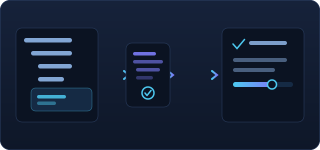

## できること

- **プロジェクトを読む**: Unity を開かずに、アバター、シーン、Prefab、導入済みパッケージ、参照切れを調べます。
- **衣装トグル**: シーンに配置した衣装を、Expression メニューからオン・オフできるようにします。
- **色違い**: アバターや衣装に付属の PSD から、衣装・肌・髪・瞳の色違いや、ロゴを入れたテクスチャを作り、メニューで切り替えます（[PhotoCraft](https://getartcraft.com/apps/photocraft) を使用）。
- **lilToon の調整**: PSD が無くても、lilToon のマテリアルの値（主色・色調補正・影・輪郭線・発光・リムライト）を変えた複製を作り、メニューで切り替えます。
- **体型の調整**: FBX を変えずに、シェイプキーで体型を変え、衣装を体に追従させ、服の下に隠れる部分をビルド時に削除します。
- **小物の取り付け**: 帽子・髪・小物・衣装をボーンに付けたり、骨組みを統合したりして、メニューで出し入れできるようにします。付けている間は元の髪を隠すこともできます。
- **Blender**: 小物を作ります（帯・紐・回転体・板の形、左右対称、頭や髪の表面に沿わせる、揺れ用のボーンと PhysBone）。別アバター用の髪や衣装（非対応衣装）は、骨格と元のアバターとの体型差に合わせて変形し、体型キーも衣装に作って、取り付け・追従・服の下の体の削除まで続けて行います（[Blender](https://www.blender.org/) を使用）。
- **表情**: ハンドジェスチャーの表情の差し替え、メニューで選ぶ表情の固定、ほほ染めなどのトグルを、アバターのアニメーターを変えずにレイヤーを足して作ります。
- **手に持つ小物**: 小物を手に持たせ、メニューの「置く」でその場に残せます。ワールドに固定する小物も作れます。
- **更新の引き継ぎ**: アバターの新しい版に、このプラグインで入れた改変をまとめてかけ直します。手で変えた値は一覧にします。
- **揺れ物**: 髪・スカート・しっぽの PhysBone の値（揺れ方、掴める・ポーズできるか）を変え、脚などにコライダーを足して貫通を防ぎます。
- **目線と大きさ**: ビューポイントを両目の間に置き直し、頭・手などをボーン単位で大きく・小さくします。
- **メニューの整理**: ビルド後のメニュー（VRCFury・Modular Avatar の項目を含む）を一覧にし、項目の移動・名前の変更・アイコン・並べ替えを、作者のメニューを変えずに行います（VRCFury を使用）。
- **ポリゴン削減**: [Meshia](https://github.com/RamType0/Meshia.MeshSimplification) で、FBX を変えずにビルド時に三角形数を減らします。顔と小さなメッシュは残します。
- **軽量化**: Avatar Optimizer の Trace and Optimize（メッシュ統合、不要なボーン・オブジェクト・シェイプキーの削除）と TexTransTool（テクスチャ縮小、マテリアル統合）を、ファイルを変えずにビルド時に効かせます。ビルドした前後の数を比べてから適用します。
- **Inspector の値の読み取り**: コンポーネントの値を、Inspector と同じ項目名・Prefab からの変更の有無つきで読みます。
- **Quest（Android）版**: [VRCQuestTools](https://github.com/kurotu/VRCQuestTools) で、同じシーンから Android 版を作ります（モバイル用シェーダー、テクスチャの縮小、揺れ物の削減）。Android としてビルドしたコピーで Mobile のランクを測ります。PC 版は変わりません。
- **パラメータ容量**: 同期するパラメータの使用量（上限 256 bit）をビルド後の状態で数え、トグルを足す前に残りを示します。
- **試して直すループ**: 「もっとふわっと」「食い込まないように」を数値の目標に置き換え、保存せずに試しては直し、結果を見せてから適用します。
- **揺れ物を動かして測る**: Play モードでアバターを揺らし・歩かせ・座らせ、揺れ物の振れ・収まるまでの時間・脚への食い込みを測ります。レシピはメモリ上で試して比べられます。
- **再生テスト**: ビルドしたアバターをジェスチャー・メニューで動かし、表情やトグルが効くかを確かめます（Gesture Manager の代わり）。
- **確認**: 適用後に VRChat SDK の前処理でメニューとアニメーションを確かめます。色違いは、Unity で撮影した改変前後の画像でも確認します。

## 安全のための約束

- 最初はファイルを読むだけです。変更の前に、対象と作られるファイルを示して確認を取ります。
- 変更は Unity の Editor スクリプト経由で行い、シーンや Prefab の YAML を直接書き換えません。
- 元の PSD・テクスチャ・マテリアル・FBX・prefab は上書きしません。変更は Git の差分で確認・復元できます。
- アップロードは行いません。

## 前提

Unity 2022.3.22f1 と有効なライセンス、VCC または ALCOM、VRChat SDK - Avatars が入ったプロジェクト、Git、Python 3.10 以上。衣装トグルと色違いには VRCFury を使います。
