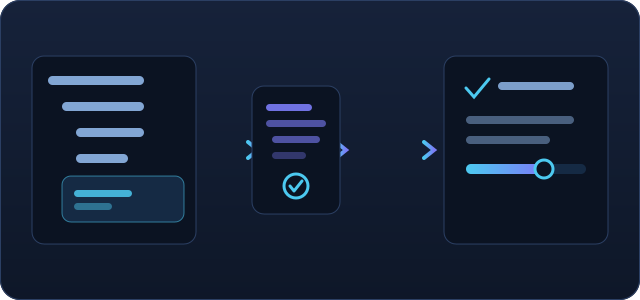

## What it does

- **Read the project** without opening Unity: avatars, scenes, prefabs, installed packages and missing references.
- **Outfit toggles**: make an outfit placed in the scene switchable from the Expression menu.
- **Color variants**: make outfit, skin, hair and eye color variants, or add a logo, from the avatar's layered PSDs, and switch them from the menu (uses [PhotoCraft](https://getartcraft.com/apps/photocraft)).
- **Body shape**: change blendshapes, make outfits follow the body, and remove body parts hidden under clothes at build time, without editing the FBX.
- **Accessories**: attach hats, hair, accessories or outfits to a bone or merge their armature, switch them from the menu, and hide the original hair while they are on.
- **Blender**: make simple shapes. Hair and outfits made for another avatar are fitted to this avatar's skeleton and to the body-shape difference from the avatar they were made for, get the avatar's body shape keys, and are then attached, made to follow the body, and the body hidden underneath removed (uses [Blender](https://www.blender.org/)).
- **Verify**: check the generated menu and animations with VRChat SDK preprocessing; color variants are also rendered before and after in Unity.

## Safety

- It starts read-only, and shows the targets and the files it will create before any change.
- Changes go through Unity Editor scripts; scene and prefab YAML is never edited directly.
- Original PSDs, textures, materials, FBX and prefabs are never overwritten, and every change can be reviewed and restored with Git.
- It never uploads.

## Requirements

Unity 2022.3.22f1 with an activated licence, VCC or ALCOM, a project with VRChat SDK - Avatars, Git, and Python 3.10 or later. Outfit toggles and color variants use VRCFury.
